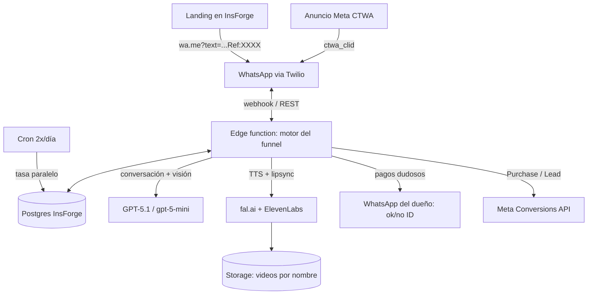

# Plan maestro — Chatbot de ventas por WhatsApp «Modelos IA» (9 USD todo incluido)

**Fecha:** 11 de junio de 2026
**Estado:** Pendiente de luz verde del dueño para iniciar implementación (Fase 1)
**Investigación de respaldo:** carpeta [investigacion/](investigacion/) — 6 informes + verificación de cifras contra fuentes oficiales (9 agentes, datos verificados el 11-jun-2026)

---

## 1. Resumen ejecutivo

Se construirá un chatbot de ventas en WhatsApp que recibe leads desde anuncios de Facebook/Instagram (click-to-WhatsApp), los recibe con un saludo profesional + **un video de ~6 segundos de un avatar femenino que saluda al lead por su nombre** (demo viva del producto), conduce la venta del paquete completo (13 módulos + 4 bonos) a **9 USD pago único**, cobra por **transferencia manual** (Pago Móvil/BDV en Venezuela; Nequi/Daviplata/Bancolombia/Bre-B en Colombia), **verifica la captura del comprobante con visión de GPT-5.1** + reglas antifraude, y entrega los enlaces de Drive automáticamente.

**Stack elegido:** Twilio (WhatsApp) + OpenAI GPT-5.1 (conversación y visión) + InsForge (backend completo) + fal.ai/ElevenLabs (videos del avatar) + ve.dolarapi.com (tasa del día).

**Cifra clave de negocio (honesta):** a 100 leads/día la infraestructura cuesta ~$0,19–0,25 por lead con Twilio. Con ticket de 9 USD y conversión del 5%, quedan ~$0,20–0,26 por lead para pagar publicidad (~$0,34–0,39 tras migrar a la API directa de Meta). El negocio funciona con Twilio si la conversión es ≥5% y el costo por conversación de anuncio es ≤$0,20–0,25; pagar $0,30–0,40 por conversación solo cierra tras migrar a Cloud API o con conversión ≥7% — el funnel demo-first está diseñado exactamente para empujar esa conversión. Hay dos palancas de margen identificadas: migrar de Twilio a la API directa de Meta (ahorra ~$405/mes) y usar mensajes de guion fijo + GPT solo para preguntas fuera de guion (estimación propia a validar en Fase 2: recortaría ~50% del costo de OpenAI).

---

## 2. Decisiones de stack

| Componente | Elección | Por qué | Costo |
|---|---|---|---|
| Canal WhatsApp | **Twilio** (fase inicial) | Lo conoce el dueño, sandbox para desarrollar desde el día 1, onboarding en horas | $0,005/mensaje (entrante y saliente) + fees Meta |
| Migración futura | Meta Cloud API directa o Gupshup/360dialog | A 100 leads/día Twilio cuesta ~$405/mes solo de fees; las alternativas, $0–81/mes | Decidir tras validar el negocio (mes 2–3) |
| LLM conversación | **gpt-5.1** (snapshot `gpt-5.1-2025-11-13`) | El dueño ya tiene créditos OpenAI; soporta tools, structured outputs, visión y prompt caching de 24 h | $1,25/M input · $10/M output · $0,125/M cacheado |
| LLM verificación de recibos | **gpt-5.1 con visión** | Un falso positivo cuesta dinero real; el sobrecosto vs mini es ~medio centavo | ~$0,007 por captura (estimado) |
| LLM tareas mecánicas | **gpt-5-mini / gpt-5-nano** | Clasificar intención, normalizar nombres de perfil. OJO: `gpt-5.1-mini` **no existe** (verificado, la URL oficial da 404) | $0,25/M · $0,05/M input |
| Backend | **InsForge** | Postgres, edge functions, storage, cron/schedules, secrets y hosting estático — cubre el 100% de la arquitectura | Según plan |
| Video avatar | **fal.ai: OmniHuman (video base, 1 vez) + veed/lipsync + OpenAI TTS** — decidido por el dueño: sin ElevenLabs | ~$0,042/video pay-per-use, sin suscripciones, avatar 100% propio. 6–7× más barato que HeyGen (calidad a validar con muestras en Fase 3). **3 videos genéricos como respaldo y grupo de control A/B (revisión a 30 días)** | ~$11 caché inicial (250 nombres) + ~$12–38/mes según volumen |
| Avatar respaldo | HeyGen API (Photo Avatar IV) | Pipeline en una sola API, máxima calidad; $0,30/video | Mínimo $5 prepago |
| Tasa del dólar | **ve.dolarapi.com** (verificada funcionando hoy) | Gratuita, sin API key; endpoints `/v1/dolares/paralelo` y `/oficial` | $0 |
| Landing page | **Híbrido 80/20**: CTWA directo (80% presupuesto) + landing minimalista en InsForge (20%, test B y retargeting) | A 9 USD cada paso extra pierde 30–60% de usuarios móviles; pero la landing habilita pixel, retargeting y amortigua el riesgo de política | Hosting incluido en InsForge |

**Nota (decisión tomada):** el TTS será **OpenAI** (`gpt-4o-mini-tts`, ~$0,002/audio, con los créditos existentes, licencia comercial incluida). ElevenLabs (Starter $6/mes) queda descartado salvo que las muestras de voz de la Fase 3 revelen una diferencia que lo justifique.

**Nota 2:** a junio 2026 OpenAI ya destaca gpt-5.4/gpt-5.5 en su pricing principal (más caros); gpt-5.1 sigue disponible y documentado. Fijar el snapshot en producción y reevaluar el modelo cada trimestre por riesgo de envejecimiento/deprecación.

---

## 3. Economía del negocio (100 leads/día, mix 70% VE / 30% CO)

### Costos de infraestructura por mes

| Concepto | Costo mensual | Por lead |
|---|---|---|
| Twilio (81.000 msgs × $0,005) | ~$405 | $0,135 |
| Meta (mensajes) | **$0 si los seguimientos van dentro de la ventana CTWA de 72 h** (verificado: todos los mensajes son gratis ahí, incluso marketing); si van fuera: hasta +$167 con 1 template/lead (la política de este plan) o +$333 con 2 | $0–0,11 |
| OpenAI (GPT-5.1 + visión + mini) | ~$280 con todo por LLM (estimado; rango $200–400); **~$120–150 con guion fijo + GPT solo fuera de guion** (recomendado — estimación propia a validar en Fase 2) | $0,04–0,09 |
| Avatar (fal + OpenAI TTS, 70% caché) | ~$38 (baja cada mes: cada nombre nuevo se suma al caché) | $0,013 |
| **Total** | **~$570–730 (Twilio) / ~$170–320 (Cloud API directa)** — asume Meta $0 (seguimientos dentro de las 72 h); peor caso con templates fuera: +$167–333. No incluye el número de Twilio (~$1–15/mes) ni el plan de InsForge | **~$0,19–0,25 / ~$0,06–0,11** |

### Escenarios de margen (antes de publicidad)

| Conversión | Ventas/mes | Ingresos | Margen por lead para ads (con Twilio) |
|---|---|---|---|
| 3% | 90 | $810 | ~$0,02–0,08 — **inviable, hay que optimizar** |
| 5% | 150 | $1.350 | ~$0,23 |
| 8% | 240 | $2.160 | ~$0,50 — cómodo |

**Conclusiones honestas:** (1) la conversión es la variable de vida o muerte — el funnel demo-first, la respuesta <60 s y los 3 seguimientos dentro de la ventana gratis existen para empujarla sobre el 5%; (2) los 3 seguimientos automáticos DEBEN caer dentro de las 72 h gratuitas del CTWA (ahorro de hasta $167–333/mes); (3) migrar de Twilio tras validar sube el margen por lead ~50–70%; (4) a futuro, subir el ticket promedio con ofertas post-venta a la base de compradores (la "lista VIP" del funnel) es la palanca más grande.

A 30 leads/día (escala de arranque) todo es proporcional: ~$170–230/mes de infraestructura total.

---

## 4. Arquitectura técnica

### Tablas Postgres (InsForge)

- `leads` — phone (PK), profile_name, nombre_normalizado, pais, estado_funnel, mayor_18, avatar_enviado, ctwa_clid, source_id (ad), ref_code, opt_out, opt_in_vip, bono_rapido_hasta, capi_sent, timestamps
- `messages` — historial completo entrante/saliente por lead (para contexto GPT y auditoría)
- `payments` — lead_phone, metodo, ref_normalizada (**UNIQUE con metodo**), monto, fecha_pago, image_phash, status, datos_extraidos (JSON), created_at
- `review_queue` — cola de revisión humana con ID corto, motivo del flag, resultado
- `exchange_rates` — fecha, fuente, tasa | `settings` — precio_bs_hoy, precio_cop, cuentas de pago, links de entrega, valido_hasta
- `videos_cache` — nombre_normalizado, storage_key, proveedor, created_at
- `funnel_events` — eventos por etapa para las métricas del embudo
- `testimonios` — texto, permiso explícito, fecha

### Edge functions

1. **webhook-twilio** — recibe mensajes/medias, persiste, despacha al motor (responder vía REST API, no TwiML: la latencia del LLM supera el timeout de 15 s del webhook)
2. **motor-funnel** — máquina de estados S00→S11 + fallback GPT-5.1 con tools (`enviar_video_avatar`, `mostrar_cuentas_pago`, `verificar_recibo`, `entregar_producto`, `escalar_a_humano`), todas con `strict:true`
3. **avatar-service** — lookup caché → hit: envío instantáneo; miss: TTS ElevenLabs + veed/lipsync (~30–90 s) con video genérico de respaldo si falla o tarda >3 min
4. **verificar-pago** — visión GPT-5.1 → JSON estricto → validaciones en código (monto/fecha/destino/estado/referencia/pHash) → auto-aprobar o cola humana
5. **capi-events** — envía `Lead` y `Purchase` a Meta (action_source: `business_messaging`, con `ctwa_clid`)
6. **comandos-dueno** — interpreta `ok 4821` / `no 4821 motivo` / `ver 4821` desde el WhatsApp del dueño

### Crons (InsForge schedules)

- **Tasa del día** 2×/día (11:45 y 17:45 UTC, alineado a las publicaciones del paralelo): API → validar sanidad (|Δ|<15%) → `precio_bs = ceil(9 × tasa_paralelo × 1,02 / 100) × 100`. La tarde solo actualiza si SUBE. Fines de semana rige la del viernes. Si la tasa guardada supera 36 h, alerta al dueño.
- **Seguimientos** — 30 min / 4 h / 20 h dentro de la ventana de 24 h; template post-24 h máximo 1 vez
- **Recordatorio cola humana** — cada 30 min si hay capturas pendientes
- **Testimonios** — tarea a 48 h post-compra
- **Pre-generación nocturna** — nombres nuevos del día se agregan al caché de videos (puede usar Kling LipSync a $0,028/video, lento pero barato)

---

## 5. El funnel de ventas — «Musa 💜 | Modelos IA»

**Decisión del dueño:** la asesora se llama **«Musa»** (coherente con Muse IA Lab). El copy de [investigacion/funnel-ventas.json](investigacion/funnel-ventas.json) usa «Valentina» como placeholder — al cargarlo a la BD en Fase 2 se reemplaza por «Musa». Copy completo, etapa por etapa, en ese archivo. Diseño: **demo-first** — el video del avatar destruye la objeción de desconfianza ANTES de pedir nada.

### Decisiones estratégicas (vs. el modelo anterior)

| Tema | Decisión | Cambio vs. anterior |
|---|---|---|
| Precio | El anuncio y la landing ya muestran $9 (decisión consciente); en el chat se confirma DESPUÉS del stack de valor pero en los primeros ~6 intercambios, y de inmediato si lo preguntan — nunca se oculta | Antes: modelo de "contribución voluntaria" — eliminado |
| Grupo de WhatsApp | Se mueve a POST-venta como comunidad de alumnos (se menciona en el stack como valor) | Antes se exigía unirse antes de comprar — fricción eliminada |
| Teaser gratis | El video del avatar ES el teaser + 1 `PROMPT_MUESTRA` táctico (solo contra objeción "¿es estafa?" y en el seguimiento de 4 h) | Nada del producto completo se entrega gratis |
| Urgencia | Solo REAL: la tasa del bolívar cambia a diario + bono «Plan de Acción 7 Días» solo para quien paga en sus primeras 24 h (con timestamp verificado) | Eliminados: contador de 5 minutos, "antes $180.000", "muchos contribuyen con $39.200" |
| Identidad | Musa admite ser asistente virtual si le preguntan y lo convierte en demo del módulo de automatización | El bot nunca finge ser humana ni ser la modelo |

### Máquina de estados

`S00 Llegada` (registro + metadatos CTWA) → `S01 Saludo` (3 mensajes con efecto tecleo) → `S02 Avatar` (video personalizado por nombre; ramas: nombre usable / preguntar nombre / genérico — **una sola vez por lead**) → `S03 País` (¿VE o CO? define moneda y cuentas) → `S04 Stack + gate 18+` (13 módulos + 4 bonos + comunidad; los bonos se listan **sin etiqueta 🔞 ni mención adulta hasta confirmar la mayoría de edad** — decisión que reconcilia el guion del funnel con la mitigación de política, ajustar el copy de S04 en Fase 2; **sin confirmación de mayoría de edad no se avanza**; menor de edad = venta bloqueada y sin seguimientos) → `S05 Precio` (9 USD con anclaje honesto + equivalente local) → `S06 Cierre` → `S07 Datos de pago` → `S08 Espera de captura` (recordatorio a 15 min) → `S09 Verificación` (expectativa real: <15 min en horario 8 am–10 pm) → `S10 Entrega` (17 enlaces en 3 bloques, nunca 17 mensajes) → `S11 Post-venta` (testimonio a 48 h + opt-in lista VIP).

Estados especiales: `S90` fallback GPT-5.1 (responde fuera de guion en ≤3 líneas y devuelve al riel), `S91` escalado a humano, `S92` menor de edad, `S93` lead frío (seguimientos 30 min / 4 h con muestra / 20 h con urgencia real).

**13 objeciones con respuesta exacta** ya redactadas (estafa, caro, entrega, principiantes, país, moneda, contenido, legalidad, mujer, garantía, por qué tan barato, "déjame pensarlo", "¿eres un bot?").

**Template post-24 h** (`reactivacion_info_pendiente`, categoría marketing, con opt-out STOP obligatorio) ya redactado para aprobación de Meta.

### Optimización de costo del funnel

Las etapas S01–S10 usan **copy fijo de la BD** (no requieren LLM). GPT-5.1 interviene solo en: fallback fuera de guion, matices de objeciones, verificación de capturas y normalización de nombres (gpt-5-nano). Esto recorta ~50% del costo OpenAI estimado y hace el funnel 100% predecible en los momentos críticos (precio, cuentas, entrega).

---

## 6. El momento avatar (diferenciador)

**Pipeline elegido (precios verificados contra páginas oficiales de fal.ai; latencias estimadas):**

1. **Una vez:** generar la imagen hiperrealista del avatar (con el propio flujo que enseña el curso — doble función de demo). El dueño la aprueba.
2. **Una vez:** video base de ~8 s con OmniHuman ($0,14/s ≈ $1,12).
3. **Por nombre:** TTS OpenAI `gpt-4o-mini-tts` voz es-LA (~$0,002, con los créditos existentes) → lip-sync con veed/lipsync ($0,40/min → 6 s = $0,04). **Total: ~$0,042/video ≈ COP 150 ≈ Bs 33; latencia ~30–90 s (estimada — el fallback de >3 min la cubre).**
4. **Caché:** pre-generar los ~250 nombres más comunes de VE/CO (~$11 una sola vez). Hit de caché = envío instantáneo. Miss = mensaje de expectativa + generación on-demand; si falla o tarda >3 min, uno de los **3 videos genéricos** (que además son el grupo de control: si a los 30 días el personalizado no convierte mejor que el genérico, se apaga con un flag sin tocar código y el ahorro va a campaña). Cada nombre nuevo se suma al caché (el hit rate sube solo).
5. El `ProfileName` de WhatsApp llega en el webhook de Twilio (confirmado) — gpt-5-nano decide si es un nombre de pila usable; si no (apodos, emojis, negocios), Musa pregunta el nombre con naturalidad.
6. **Producción:** garantizar MP4 H.264/AAC ≤16 MB con un paso de transcodificación (las edge functions necesitan ffmpeg o un servicio de conversión externo — resolver en Fase 3) y presupuestar ~5% extra por reintentos: los modelos de lip-sync fallan ~2–5%.

Guion del video (~6 s): «¡Hola {{nombre}}! Soy una modelo creada 100% con inteligencia artificial… y tú vas a aprender a crear esto. Te leo en el chat 😉» — formato MP4 H.264/AAC ≤16 MB (requisito Twilio/WhatsApp).

**Por qué no HeyGen como primario:** $0,30/video (6,7×), y riesgo de moderación del SaaS por la temática +18 del producto asociado a la cuenta. fal.ai con avatar propio elimina esa dependencia. HeyGen queda como respaldo documentado.

---

## 7. Pagos y verificación antifraude

### Venezuela (precio dinámico en Bs)

- **Cotizar SIEMPRE a tasa paralelo, nunca BCV** (hoy: paralelo 796,44 vs BCV 577,55 — brecha ~38%; cotizar a BCV sería perder 27,5% de cada venta). Fórmula: `ceil(9 × paralelo × 1,02 / 100) × 100` → hoy **Bs 7.400**.
- Métodos: **Pago Móvil a BDV** (principal), transferencia BDV, **Binance Pay 9 USDT** (opcional recomendado: público cripto-adopto, comprobante difícil de falsificar), Zelle solo si el dueño tiene cuenta US.
- API de tasa: `ve.dolarapi.com` (verificada funcionando hoy); pydolarve como fallback codificado (hoy caída); tercer nivel: última tasa guardada.

### Colombia (precio fijo)

- **33.000 COP** (9 USD × TRM 3.513 + colchón 4,4%, redondo y fácil de validar). Revisar manualmente solo si la TRM sale de 3.300–3.700.
- Métodos: Nequi, Daviplata, Bancolombia, **llave Bre-B** (una sola llave cubre todos los bancos).

### Verificación de capturas (GPT-5.1 visión + reglas en código)

- El LLM extrae JSON estricto: método, monto, fecha, referencia, destino, estado, `es_captura_completa`, `senales_manipulacion` + confidence por campo.
- **Las decisiones las toma el código, no el LLM:** monto ≥ precio del día (y ≤3×), fecha = hoy/≤24 h y nunca futura, destino exacto, estado = exitosa (rechazar "programada"/"en proceso" — el fraude nº 1 de Bancolombia), formato de referencia válido por banco, confidence ≥0,85, sin señales de manipulación, captura completa y primer pago de ese teléfono.
- **Dedupe:** UNIQUE (método, referencia normalizada) + pHash de la imagen (captura reutilizada = fraude nº 1 general) + índice (monto, fecha, banco emisor).
- **Circuit breaker:** máx. 10 auto-aprobaciones/hora y máx. 3 del mismo banco emisor en 10 min; si se supera, todo pasa a humano + alerta (patrón de ataque con generador de comprobantes).
- **Cola humana:** notificación inmediata al WhatsApp del dueño con captura + JSON + ID corto; comandos `ok 4821` / `no 4821 motivo` / `ver 4821`. Zelle y Bancolombia siempre a humano al inicio.
- El bot **nunca acusa**: respuestas suaves ya redactadas para captura ilegible, referencia duplicada y pago en proceso.
- **Ruta de escala futura** (>30 ventas/día): cuenta jurídica Banco Mercantil (portal API público con "Búsqueda de Transferencias", verificado) en VE y Nequi Conecta en CO para conciliación automática de fondo. Mientras tanto, red de seguridad gratuita: conciliación manual nocturna — exportar los movimientos del día desde la app del banco y cruzarlos contra `payments` con un cron.

---

## 8. Tráfico: anuncios y landing

**Veredicto: híbrido 80/20 con sesgo a CTWA directo.** La venta SIEMPRE termina en el chat (no existe checkout web con pago manual), así que la landing intermedia solo agrega fricción como adquisición — pero vale como test, pixel y retargeting.

- **Campaña A (80%):** objetivo Interacción → WhatsApp, audiencia amplia Advantage+ 18–44, ad sets separados VE y CO (métodos de pago distintos). Mensaje prellenado: «Hola, quiero info del curso Modelos IA».
- **Campaña B (20%):** objetivo Ventas optimizado por evento `Contact` del pixel en la landing (InsForge static hosting).
- **Precio $9 visible en TODAS partes** (anuncio, landing, chat): es el gancho, pre-califica gratis y baja el perfil anti-scam ante Meta.
- **Tracking (el upgrade que casi nadie hace en LATAM):** capturar `ctwa_clid` del webhook → enviar `Purchase` real vía **Conversions API for Business Messaging** al verificar cada pago → cuando haya ≥25–50 compras/semana, migrar la campaña a optimización por Purchase (Meta deja de buscar "gente que chatea" y busca "gente que paga"). Atribución last-click de 7 días. OJO: que Twilio exponga `ReferralCtwaClid` en el webhook está marcado como **estimado** en la investigación — confirmarlo es criterio de salida de la Fase 1; plan B: matching por ventana temporal.
- **Landing → chat:** el identificador viaja DENTRO del texto prellenado (`...Ref: LP-7F3K`) porque WhatsApp ignora los UTM del enlace wa.me. Código generado por sesión en edge function. Pérdida esperada: 10–25% de usuarios borra el texto prellenado; fallback: matching por ventana temporal de ±3 min.
- **Día 14:** comparar CPA real por pago verificado (no CPL). Si A ≤ 0,6×B, consolidar en A y dejar la landing solo para retargeting.

### Creativos que pasan revisión (sin engaño)

Ángulo habilidad/demo: «Aprende a crear modelos virtuales hiperrealistas con IA — 13 módulos + 4 bonos, $9 pago único», video del proceso con reveal «¿notaste que no es real?», modelo SIEMPRE vestida estilo lifestyle, **divulgación de contenido IA activada** (categoría top de rechazos en 2026 y además demuestra el producto). **Prohibido en ads y landing:** cualquier mención/insinuación +18, cifras de ingresos, screenshots de ganancias. La imagen actual de campaña (estilo "gana dinero" + modelo sugerente) tiene alta probabilidad de rechazo — producir los 3 creativos nuevos descritos en [investigacion/landing-ads.json](investigacion/landing-ads.json).

---

## 9. Riesgos y cumplimiento (lectura obligatoria)

**Riesgo de política WhatsApp: MEDIO-ALTO a ALTO** (dos factores acumulativos: temática +18 y venta de contenido digital descargable). La WhatsApp Business Policy lista "productos y servicios para adultos" como categoría prohibida y los bonos +18 encajan razonablemente ahí, aunque el curso principal sea educativo. La detección es mayormente reactiva (reportes de usuarios), pero un solo reporte puede escalar a revisión humana y baneo permanente del número — y potencialmente del Business Manager.

**Reglas operativas:**
1. El copy del chat jamás es explícito ni describe el material +18 (solo nombra el bono); las imágenes explícitas viven en el Drive, nunca en el chat.
2. Gate 18+ obligatorio y registrado en BD antes de detallar/entregar bonos.
3. Tratar el **número como activo desechable** y el **Business Manager como activo crítico** (verificar el negocio, display name limpio, dominio verificado).
4. Máximo 3 seguimientos en ventana + 1 template post-24 h; STOP es permanente; responder rápido; monitorear el quality rating semanalmente. Ojo: Meta aplica frequency capping a templates de marketing y puede recategorizar un template utility como marketing (cambia su precio).
5. La entrega rápida post-pago y el soporte real son la mejor defensa: los reclamos por no-entrega son la vía nº 1 de reportes.
6. NO hacer: granjas de números, evasión de baneos, catálogos de WhatsApp con el curso.

**Lista negra del bot** (cargada en el system prompt y validada en tests): nunca inventar compradores/contadores/precios "antes" falsos/testimonios; nunca prometer ingresos; nunca urgencia falsa; nunca fingir ser humana ante pregunta directa; nunca pedir claves/OTP; nunca entregar sin pago verificado; nunca prometer tiempos que no se cumplen.

---

## 10. Plan de implementación agéntica (Fable 5 + Ultracode)

Cada fase se ejecuta como un **workflow multi-agente** con verificación adversarial integrada; entre fases, revisión y aprobación del dueño. Los loops de verificación repiten hasta cumplir criterios de salida — no hasta "parece que funciona".

| Fase | Contenido | Verificación (loop adversarial) | Estimado |
|---|---|---|---|
| **0. Insumos** | El dueño entrega accesos y datos (ver §11) | Checklist completo | 1 día (dueño) |
| **1. Cimientos** | Proyecto InsForge (skill insforge-cli), esquema Postgres completo, secrets, cron de tasa, webhook Twilio eco en sandbox | Tests del esquema + eco funcional en sandbox + tasa guardándose 2×/día + **confirmar que el webhook de Twilio expone `ReferralCtwaClid`** (si no, activar plan B de matching temporal) | 1 sesión |
| **2. Motor del funnel** | Máquina de estados S00–S93, copy en BD, GPT-5.1 con tools, seguimientos programados | **Workflow de compradores simulados**: agentes-persona (desconfiado, apurado, menor de edad, preguntón, colombiano, venezolano, troll, "¿eres bot?") conversan contra el bot en loop hasta 0 violaciones de lista negra, gate 18+ infranqueable y precio/cuentas correctos por país | 1–2 sesiones |
| **3. Avatar** | Imagen del avatar (aprueba el dueño), video base OmniHuman, pipeline TTS+lipsync, caché 250 nombres, integración Twilio media | Muestra con 10 nombres difíciles (Yusneidi, Wuilmer, Génesis…) + fallback genérico verificado + formato MP4 válido en WhatsApp real | 1 sesión |
| **4. Pagos** | Prompt de visión, validaciones, dedupe, circuit breaker, cola humana + comandos del dueño, entrega automática | Set adversarial de comprobantes de prueba (legítimos, reutilizados, editados, "programados", monto menor, destino ajeno) en loop hasta precisión objetivo: 0 falsos positivos de entrega, <15% falsos envíos a cola | 1–2 sesiones |
| **5. Landing + tracking** | Landing estática (bloques definidos en investigación), pixel, CAPI business messaging, captura ctwa_clid y códigos Ref | Eventos Purchase/Lead visibles en Events Manager de prueba; landing <2 s en 3G | 1 sesión |
| **6. Lanzamiento** | Registro del número real (self sign-up Twilio), display name, templates a aprobación, campañas A/B presupuesto bajo 3–5 días | `/loop` de monitoreo: cola de revisión, quality rating, tasa del día, errores de webhook; criterios de escalado +20–30% cada 2–3 días | 3–7 días |
| **Mejora continua** | Cluster semanal de objeciones del fallback GPT (cron) → ajustes de copy; decisión de migrar Twilio→Cloud API; ofertas a lista VIP | Métricas §5 del funnel; CPA real por anuncio vía CAPI | permanente |

Mientras Meta verifica el negocio (1 día–3 semanas, variable, **con riesgo real de rechazo** para un negocio informal sin web sólida — si rechaza, se opera con el límite de 250 templates/día, suficiente al inicio porque las respuestas a leads CTWA no lo consumen, mientras se subsana), TODO el desarrollo avanza en el sandbox de Twilio (límites del sandbox: la sesión del tester expira a los 3 días, 1 mensaje cada 3 s, solo 3 templates genéricos) — no hay tiempo muerto. El registro del sender en producción limitada (250 templates/día, suficiente al inicio porque las respuestas a leads CTWA no consumen ese límite) sale en 1–2 días.

---

## 11. Insumos y decisiones pendientes del dueño

**Decisiones tomadas (11/12-jun-2026):**
1. ✅ **Enlaces confirmados**: [enlaces.txt](enlaces.txt) ahora tiene 17 enlaces numerados. Mapeo: 1–13 módulos, 14 Colección +20 modelos IA, 15 Audios FemPro, 16 YouTube Money Machine, 17 MegaPack Master IA.
2. ✅ **Avatar**: personalizado a 6 s, fal.ai (veed/lipsync) + **OpenAI TTS** (sin ElevenLabs) ≈ $0,042/video + **3 videos genéricos** como respaldo y grupo de control; revisión del A/B a 30 días.
3. ✅ **Asesora: «Musa»** (reemplaza a «Valentina» en todo el copy al cargarlo en Fase 2).
4. ✅ **Bono «Plan de Acción 7 Días»**: aprobado — PDF en [bonos/](bonos/).
5. ✅ **Métodos de pago por ahora**: VE = Banco de Venezuela; CO = Bancolombia, Nequi, Bre-B. Sin Daviplata, Binance ni Zelle por el momento. Datos en [config/datos-pago.md](config/datos-pago.md).
6. ✅ **Precio Colombia: 33.000 COP** (confirmado 12-jun).
7. ✅ **Display name: «Modelos IA»** — coherencia anuncio→chat (el lead hace clic en el anuncio del "curso Modelos IA" y llega a un chat con el mismo nombre). Respaldo si Meta lo rechaza por genérico: «Muse IA Lab».
8. ✅ **Datos de pago VE provisionales**: el dueño aún no tiene cuenta/Pago Móvil definitivos — se cargan placeholders marcados PROVISIONAL (solo desarrollo/sandbox). 🚫 **BLOQUEO DE LANZAMIENTO: la Fase 6 no arranca con datos VE provisionales.**

**Decisiones / datos aún pendientes:**
1. 🚫 **Datos de pago VE reales** (Pago Móvil: teléfono + cédula + titular; cuenta BDV de 20 dígitos + titular) — bloqueo de lanzamiento, no de desarrollo.
2. Titulares parciales para mostrar en el chat (Nequi/Bre-B, formato «Mau** Bon**»).
3. ¿Número de WhatsApp: comprar uno en Twilio o usar un número propio? (No debe estar registrado en otra cuenta de WhatsApp.)

**Insumos (Fase 0) restantes:**
- API key de OpenAI; acceso al proyecto InsForge
- Cuenta fal.ai (pendiente — registro gratis, pay-per-use; se necesita recién en Fase 3)
- Meta Business Manager con admin + cuenta publicitaria activa + documentos para verificación del negocio
- Link del grupo privado de alumnos (crearlo nuevo)
- Aprobación de la imagen del avatar (la generamos en Fase 3)

---

## 12. Fuentes clave (verificadas 11-jun-2026)

Precios fal.ai/ElevenLabs/HeyGen/A2E: páginas oficiales (confirmado por verificador). Twilio $0,005/msg y reglas de media: twilio.com. Modelo Meta por mensaje (1-jul-2025), tarifas VE $0,074 / CO $0,0125 marketing (triangulación de 3 fuentes consistentes — confirmar centavo en el rate card oficial al presupuestar), ventana de servicio 24 h gratis y CTWA 72 h todo gratis: whatsappbusiness.com + docs BSP. GPT-5.1 $1,25/$10/$0,125 y la inexistencia de gpt-5.1-mini: developers.openai.com (oficial). Tasas del día: ve.dolarapi.com (paralelo 796,44 / BCV 577,55) y TRM 3.513,54 (datos.gov.co). Detalle completo con URLs en cada JSON de [investigacion/](investigacion/).
